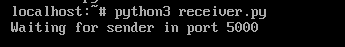
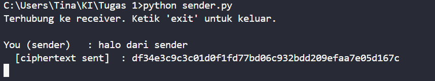
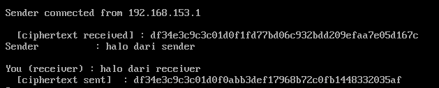

Simulasi transmisi/komunikasi data two-way menggunakan algoritma enkripsi dekripsi DES. `sender.py` dijalankan di sisi pengirim (host windows), dan `receiver.py` dijalankan di sisi penerima (vm linux). 

Di simulasi ini, sender dan receiver sama-sama sudah mengetahui key-nya. Key tidak dikirimkan dalam transmisi.

 

`receiver.py` dijalankan lebih dahulu dan menunggu koneksi di port 5000.

 

sender mengirim pesan pertama

 

receiver menerima pesan dari sender, dan mengirim kembali balasan pesan.